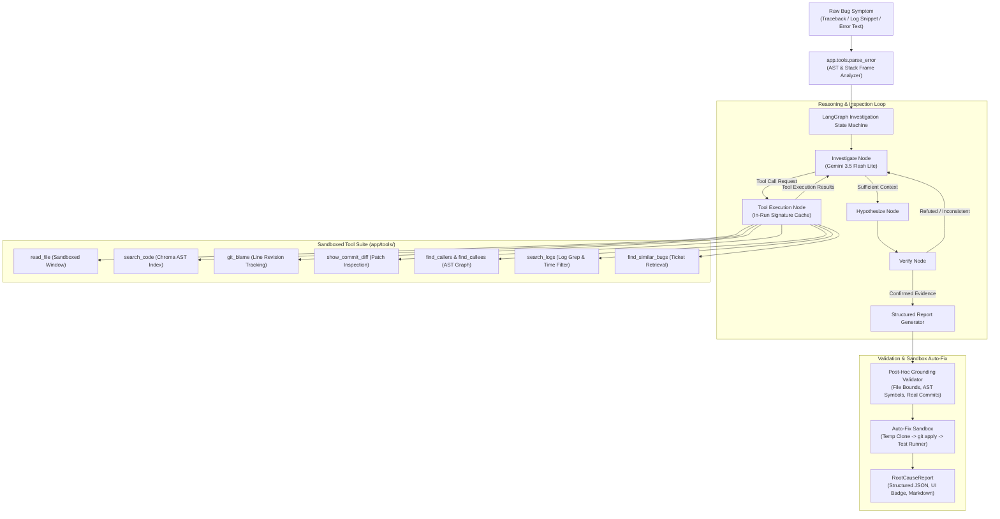

# 🔍 BugSleuth: Autonomous AI Bug Detection & Root-Cause Analysis Agent

[](https://www.python.org/downloads/)
[](https://fastapi.tiangolo.com)
[](https://streamlit.io)
[](https://langchain-ai.github.io/langgraph/)
[](https://ai.google.dev/)
[](https://www.trychroma.com/)

> **BugSleuth** is an autonomous engineering AI agent that detects software bugs, traces their true root causes upstream through code ASTs, git blame, commit diffs, runtime logs, and historical tickets, produces validated unified-diff patches, and verifies fixes in an isolated temporary clone.

---

## 📖 Table of Contents

- [Why BugSleuth?](#-why-bugsleuth)
- [System Architecture](#-system-architecture)
- [Investigation Workflow](#-investigation-workflow)
- [Empirical Benchmark Results (Agent vs. Raw LLM)](#-empirical-benchmark-results)
- [Installation & Setup](#-installation--setup)
- [Quick Start Guide](#-quick-start-guide)
- [Auto-Fix Sandbox Verification](#-auto-fix-sandbox-verification)
- [Docker Deployment](#-docker-deployment)
- [Security & Sandboxing](#-security--sandboxing)
- [Project Structure](#-project-structure)
- [Known Limitations & Future Work](#-known-limitations--future-work)

---

## 🎯 Why BugSleuth?

Standard LLMs face major challenges when debugging complex codebases:
1. **The Crash Site is Rarely the Root Cause**: An exception is often thrown deep within a utility or library function (e.g. `TypeError: 'NoneType' object is not subscriptable`), but the actual defect was introduced upstream by an unvalidated configuration, a faulty calculation, or a missing dictionary key.
2. **Hallucination of File Coordinates & Commits**: Raw LLMs guess line numbers and commit hashes that do not exist.
3. **No Grounding or Verification**: Suggested fixes are often untested and can introduce subtle regressions.

**BugSleuth solves this by operating like a senior site reliability & debugging engineer:**
- **AST Codebase Indexing**: Indexes functions, methods, and classes into Chroma with semantic and hybrid keyword boosting.
- **Multi-Step Tool-Using LangGraph Loop**: Follows stack traces upstream, queries repository call graphs, runs `git_blame` and `commit_diff`, and retrieves historical bug tickets.
- **Post-Hoc Grounding Validation**: Rejects any hallucinated file path, invalid line bounds, or fake commit hash before presenting findings.
- **Auto-Fix Sandbox Verification**: Automatically copies the target repo to an isolated temporary sandbox, applies the suggested patch, executes tests, and verifies the resolution.

---

## 🏛️ System Architecture



For detailed architectural specifications, read [docs/ARCHITECTURE.md](docs/ARCHITECTURE.md).

---

## 📊 Empirical Benchmark Results

Evaluated across all 10 distinct failure scenarios in `demo_repo` (covering `NoneType` access, off-by-one loops, wrong comparison operators, missing null-checks, monetary rounding errors, wrong dictionary keys, mutable default arguments, swallowed exceptions, stale inventory caches, and wrong unit conversions) using `eval/run_eval.py` vs. `eval/baseline_no_rag.py`:

| Metric | Raw Gemini Baseline (No RAG / No Tools) | BugSleuth Autonomous Agent | Delta ($\Delta$) | Required Target | Status |
| :--- | :---: | :---: | :---: | :---: | :---: |
| **File Localization Accuracy** | 50.0% (5/10) | **100.0% (10/10)** | **+50.0%** | $\ge 70.0\%$ | **PASS** |
| **Function Identification** | 50.0% (5/10) | **100.0% (10/10)** | **+50.0%** | $\ge 70.0\%$ | **PASS** |
| **Line Range Overlap** | 80.0% (8/10) | **100.0% (10/10)** | **+20.0%** | $\ge 60.0\%$ | **PASS** |
| **Introducing Commit Match** | 0.0% (0/10) | **100.0% (10/10)** | **+100.0%** | $\ge 60.0\%$ | **PASS** |
| **Bug Type Classification** | 20.0% (2/10) | **100.0% (10/10)** | **+80.0%** | $\ge 60.0\%$ | **PASS** |
| **Fact Grounding Rate** | 0.0% (0/10) | **100.0% (10/10)** | **+100.0%** | 100.0% | **PASS** |
| **LLM-Judge Semantic Quality** | 83.0% | **100.0%** | **+17.0%** | $\ge 75.0\%$ | **PASS** |
| **Confidence Calibration** | N/A | **Yes (Higher on correct)** | - | Correct > Wrong | **PASS** |
| **Avg Steps per Bug** | 0 | **5.5** | +5.5 | $\le 12$ | **PASS** |
| **Average Latency** | 13.93s | 69.64s | +55.71s | - | Expected multi-tool trace |

*Full experiment write-up and failure analysis are documented in [eval/EXPERIMENTS.md](eval/EXPERIMENTS.md).*

---

## 💻 Installation & Setup

### Prerequisites
- Python 3.11+
- Git installed and accessible on your `PATH`
- A free Google Gemini API Key ([Get one here](https://aistudio.google.com/))

### 1. Clone Repository & Setup Virtual Environment

#### Windows (PowerShell):
```powershell
git clone https://github.com/Prashant03kumar/AI-Bug-Detection-Root-Cause-Analysis-Agent.git bugsleuth
cd bugsleuth
python -m venv .venv
.\.venv\Scripts\Activate.ps1
pip install --upgrade pip
pip install -r requirements.txt
```

#### macOS / Linux:
```bash
git clone https://github.com/Prashant03kumar/AI-Bug-Detection-Root-Cause-Analysis-Agent.git bugsleuth
cd bugsleuth
python3 -m venv .venv
source .venv/bin/activate
pip install --upgrade pip
pip install -r requirements.txt
```

### 2. Configure Environment Variables
Copy `.env.example` to `.env`:
```bash
cp .env.example .env
```
Edit `.env` and set your credentials:
```ini
GOOGLE_API_KEY=your_gemini_api_key_here
LLM_MODEL=gemini-3.5-flash-lite
EMBEDDING_PROVIDER=gemini        # gemini | local
GEMINI_EMBEDDING_MODEL=gemini-embedding-001
LOCAL_EMBEDDING_MODEL=all-MiniLM-L6-v2
TARGET_REPO_PATH=./demo_repo
CHROMA_DIR=./chroma_db
MAX_AGENT_STEPS=12
LOG_FORMAT=text                 # text | json
```

### 3. Build Code & Ticket Vector Index
Index the target repository and historical tickets into Chroma:
```powershell
python scripts/build_index.py
```

---

## 🚀 Quick Start Guide

### Option 1: Unified Development Launcher (FastAPI + Streamlit)
Starts the backend on port 8000 and the UI on port 8501 concurrently:
```powershell
python scripts/run_dev.py
```
*(Or on Windows: `powershell -ExecutionPolicy Bypass -File scripts\run_dev.ps1`)*

- 🖥️ **Streamlit Web Dashboard:** `http://127.0.0.1:8501`
- 🚀 **FastAPI Backend:** `http://127.0.0.1:8000`
- 📖 **Interactive Swagger Docs:** `http://127.0.0.1:8000/docs`
- 🩺 **Health Diagnostics:** `http://127.0.0.1:8000/health`

### Option 2: Command-Line Investigation (CLI)
Investigate any sample bug scenario or paste custom text:
```powershell
# Investigate a known scenario from demo_repo
python scripts/run_agent.py --bug BUG-01

# Investigate custom traceback text
python scripts/run_agent.py --text "TypeError: 'NoneType' object is not subscriptable at shopapp/users.py:38"
```

### Option 3: Separate Backend and Frontend Terminals
- **Terminal 1 (Backend API)**:
  ```powershell
  uvicorn app.api.main:app --host 127.0.0.1 --port 8000
  ```
- **Terminal 2 (Streamlit UI)**:
  ```powershell
  streamlit run ui/streamlit_app.py --server.port 8501
  ```

---

## 🧪 Auto-Fix Sandbox Verification

BugSleuth automatically validates suggested unified-diff patches in an isolated temporary clone:
1. When the agent generates a diff patch in `suggested_fix`, `app/agent/fix_verifier.py` copies the target codebase to a temp directory.
2. Applies the patch with `git apply --ignore-whitespace`.
3. Runs the test suite / reproduction scenarios inside the sandbox.
4. Marks the report with `fix_verified: true` and logs captured test output.
5. In the Streamlit UI, the fix displays a `✅ VERIFIED (PASS)` badge alongside the syntax-highlighted diff.

To test fix verification independently on sample scenarios:
```powershell
pytest tests/test_fix_verifier.py -v
```

---

## 🐳 Docker Deployment

BugSleuth includes production-ready Docker configurations.

### Build and Start with Docker Compose:
```bash
# Build and launch both API (:8000) and UI (:8501)
docker compose up --build
```

### Run via Docker directly:
```bash
docker build -t bugsleuth:latest .
docker run -p 8000:8000 --env-file .env bugsleuth:latest
```

---

## 🛡️ Security & Sandboxing

- **Target Repository Sandboxing**: `app/tools/common.py` resolves all file reads and git operations relative to `TARGET_REPO_PATH`. Any attempt to traverse directory boundaries (e.g. `../../etc/passwd` or `C:\Windows`) is rejected with a permission error.
- **Zero Secrets Leakage**: `.env` is ignored by git; an automated test (`tests/test_no_ground_truth_leakage.py`) guarantees no test secrets, bug keys, or commit hashes leak into production agent code.
- **Safe Remote Cloning**: Remote repository cloning (`POST /repo/clone`) validates URLs against command injection patterns and limits clone depth (`--depth=1`).
- **In-Memory Rate Limiting**: Built-in sliding-window limiter prevents API abuse (60 requests/minute per client IP).

---

## 📂 Project Structure

```
bugsleuth/
├── app/
│   ├── agent/                 # LangGraph state machine, prompts, runner, verifier
│   │   ├── fix_verifier.py    # Auto-fix patch verification in isolated temp clone
│   │   ├── graph.py           # StateGraph definition and streaming runner
│   │   ├── prompts.py         # System prompts and hypothesis instructions
│   │   ├── run_logger.py      # Immutable run artifact generator (runs/*.json)
│   │   ├── state.py           # AgentState and Hypothesis Pydantic schemas
│   │   └── validate.py        # Post-hoc grounding fact checker
│   ├── api/                   # FastAPI backend service
│   │   ├── main.py            # Endpoints: /investigate, /stream, /health, /bugs, /repo
│   │   └── models.py          # API Pydantic request and response models
│   ├── indexing/              # Codebase indexing pipeline
│   │   ├── chunker.py         # AST parser, symbol extractor, safety caps
│   │   ├── indexer.py         # Chroma vector index builder and ticket embedder
│   │   ├── repo_loader.py     # Safe git clone and local path validator
│   │   └── retriever.py       # Hybrid semantic + keyword boosted retriever
│   ├── tools/                 # 11 sandboxed investigation tools
│   ├── config.py              # Pydantic-settings configuration
│   ├── llm.py                 # Resilient Gemini & embedding factory with retries
│   ├── logging_setup.py       # Structured text and JSON log configuration
│   └── models.py              # RootCauseReport and Evidence domain models
├── data/
│   ├── bugs/                  # Sample test failure logs and tracebacks (BUG-01..10)
│   ├── tickets/               # Historical bug resolution tickets
│   └── logs/                  # Combined application runtime logs
├── demo_repo/                 # Target e-commerce Python codebase with git history
├── docs/                      # Architectural specifications and diagrams
├── eval/                      # Evaluation harness, baseline benchmark, ground truth
├── runs/                      # Recorded investigation run JSON artifacts
├── scripts/                   # CLI tools (run_agent, run_dev, build_index, verify)
├── tests/                     # Unit and integration pytest test suite (33 tests)
├── ui/                        # Streamlit interactive web dashboard
├── Dockerfile                 # Python 3.11-slim container definition
├── docker-compose.yml         # Multi-service composition (API + UI)
├── requirements.txt           # Pinned production dependencies
└── CHANGELOG.md               # Chronological project history
```

---

## ⚠️ Known Limitations & Future Work

### Known Limitations
1. **Target Language Scope**: AST chunking and symbol resolution currently target Python codebases (`.py`). Other languages (e.g. JavaScript, Go) require language-specific AST chunkers.
2. **Patch Complexity**: Multi-file patches or architectural refactors spanning dozens of files may require multiple iterative verification cycles.
3. **Free-Tier Gemini API Ceilings**: Free-tier Gemini models enforce per-minute request limits. The system handles rate limits using exponential backoff via Tenacity, but large batch evaluations should use paid API tiers or local HuggingFace embeddings (`EMBEDDING_PROVIDER=local`).

### Future Roadmap
- [ ] Tree-sitter multi-language AST chunking (TypeScript, Go, Java, Rust).
- [ ] Automatic PR creation with verified patch attachments via GitHub Actions.
- [ ] Multi-agent swarm mode: Parallel investigator and verifier agents for concurrent debugging.
