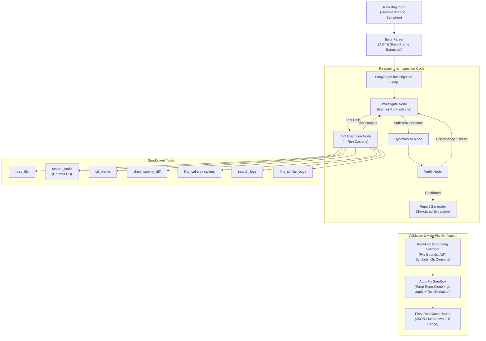
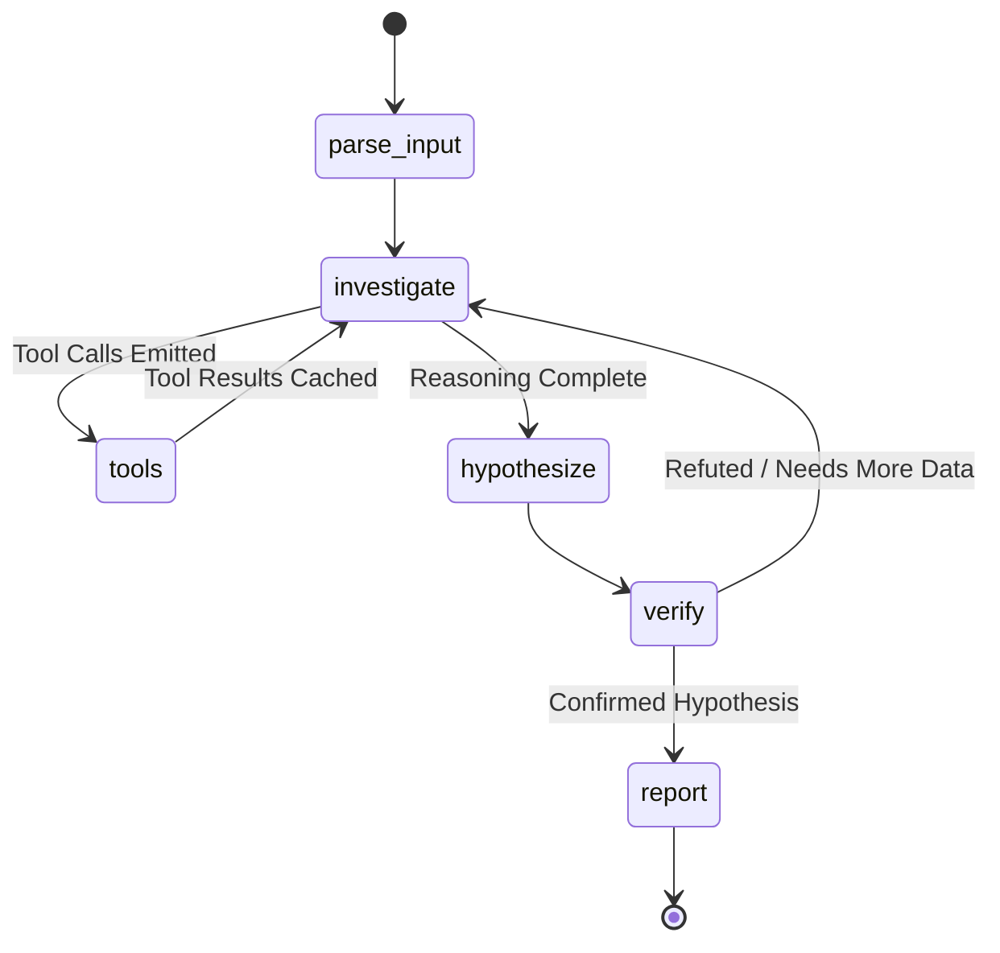
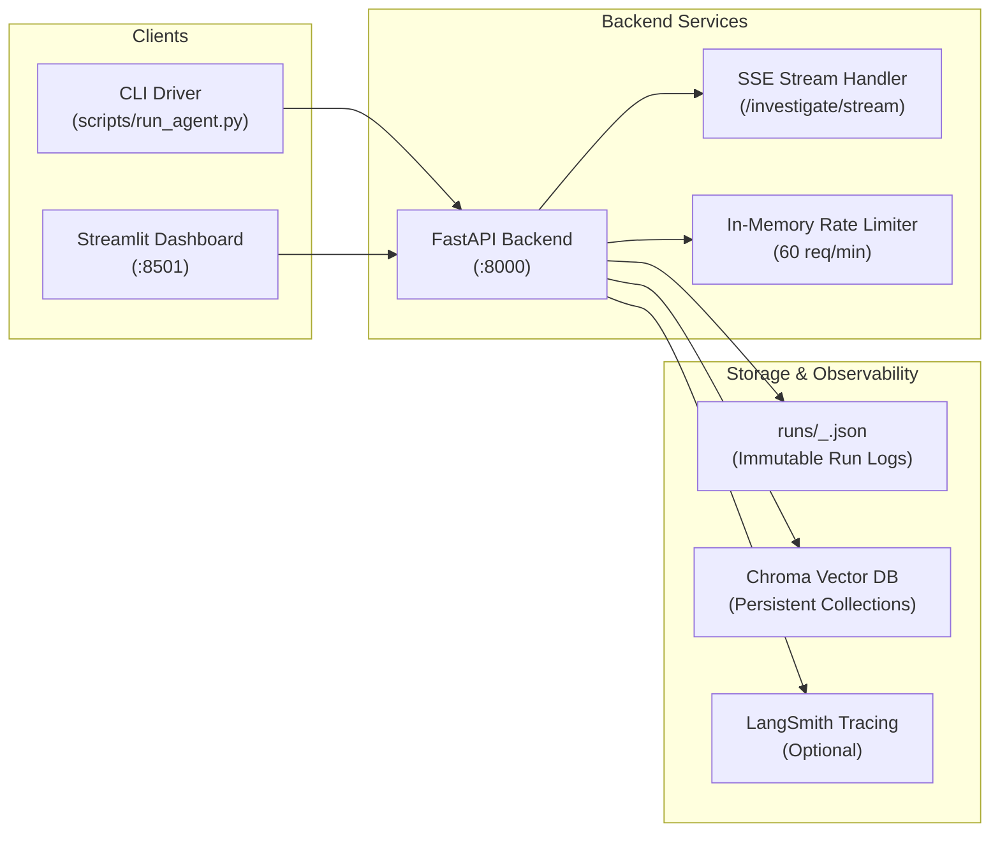

# BugSleuth Architecture Specification

## 1. System Overview

BugSleuth is an autonomous, agentic AI root-cause analysis (RCA) and bug detection system. Unlike conventional developer assistants that rely on naive text-prompting or isolated retrieval, BugSleuth investigates software bugs using a multi-step LangGraph state machine equipped with specialized repository inspection tools, AST call-graph reasoning, post-hoc grounding validation, and automated patch testing in isolated sandboxes.

---

## 2. Core Architectural Components

### 2.1 AST Code Chunking & Persistent Vector Indexing
- **AST Parsing (`app/indexing/chunker.py`)**:
  - Traverses the target repository and parses `.py` files using Python's native `ast` module.
  - Generates fine-grained semantic chunks:
    - **Module Overview Chunks**: Top-level symbols, docstrings, and imports.
    - **Function & Method Chunks**: Full implementation bodies, inbound call targets, and local import usage.
    - **Class Signature Chunks**: Docstrings, constructors, and method manifest (excluding method bodies to avoid chunk redundancy).
  - Prepends structured metadata headers (`# file: ... | symbol: ...`) to code text to maximize embedding retrieval fidelity.
  - Enforces large-repository protections: ignores `.git`, `node_modules`, `.venv`, and caps file size at 250 KB / 10,000 lines.
- **Persistent Chroma Store (`app/indexing/indexer.py`)**:
  - Batched vector embeddings with rate-limit backoff.
  - Maintains separate collections: `code_chunks` and `bug_tickets`.
  - Incremental indexing mode using SHA-256 file hashes stored in `file_hashes.json`.

### 2.2 Hybrid Code & Ticket Retrieval Engine (`app/indexing/retriever.py`)
- Combines semantic vector similarity with hybrid keyword boosting:
  - If a query directly names a source file (e.g. `users.py`) or AST symbol (e.g. `get_user`), cosine similarity scores receive a deterministic weight boost ($+0.25$ to $+0.35$).
  - Historical bug tickets are indexed and retrieved using cosine distance over past resolutions.

---

## 3. LangGraph Investigation State Machine

The agent reasoning workflow is implemented as a cyclical directed acyclic state graph (`langgraph`):

### 3.1 Graph Nodes & Routing
1. **`parse_input`**: Ingests raw stack traces, log messages, or user bug descriptions. Extracts innermost crash frames, exception types, and candidate search keywords.
2. **`investigate`**: ReAct reasoning node with 11 tools bound. Iteratively queries the codebase, checks revision histories via `git_blame`, inspects commit diffs, and follows upstream callers.
3. **`tools`**: Dispatches tool invocations with loop detection and in-memory call signature caching (`_TOOL_EXECUTION_CACHE`).
4. **`hypothesize`**: Formulates an explicit root-cause hypothesis linking the observed crash to the introducing code change.
5. **`verify`**: Evaluates the hypothesis strictly against gathered evidence. If contradictions are found, routes execution back to `investigate`.
6. **`report`**: Enforces strict structured output parsing into `RootCauseReport` via `llm.with_structured_output()`.

---

## 4. Sandboxed Investigation Tools (`app/tools/`)

All investigation tools execute within strict path boundaries:
- **Sandbox Boundary Enforcer (`app/tools/common.py`)**: Rejects path traversal (`../`) and absolute paths outside `TARGET_REPO_PATH`.
- **Output Truncation**: Enforces a 3,000 character maximum output cap to prevent context-window exhaustion.
- **Tool Suite**:
  - `parse_error`: Structured stack trace and traceback parser.
  - `search_code`: Queries Chroma AST vector index with hybrid scoring.
  - `read_file`: Reads numbered line windows around target coordinates.
  - `get_function_source`: Extracts complete AST source for functions/methods.
  - `find_callers` & `find_callees`: Traverses repository call graphs.
  - `git_blame`: Line-by-line revision history and commit attribution.
  - `recent_commits`: Repository commit history and file diffs.
  - `show_commit_diff`: Unified patch viewer for specific commit hashes.
  - `search_logs`: Grep-like application log query engine.
  - `find_similar_bugs`: Semantic search across historical bug tickets.

---

## 5. Post-Hoc Grounding Validator (`app/agent/validate.py`)

To eliminate LLM hallucinations, every generated report is automatically validated before presentation:
- **File Existence**: Verifies that the offending file exists in the active repository.
- **Line Range Bounds**: Checks that `line_start` and `line_end` fall within actual line counts.
- **AST Symbol Verification**: Confirms that the reported function name actually exists in the file's AST.
- **Git Revision Audit**: Checks that any reported `introducing_commit` exists in the real git history.
- **Grounding Penalty**: If any claim fails validation, `grounded` is set to `False`, confidence is capped at `0.40`, and diagnostic notes are recorded.

---

## 6. Auto-Fix Sandbox Verification (`app/agent/fix_verifier.py`)

When the agent suggests a fix containing a unified diff patch:
1. Copies the target repository to an isolated temporary sandbox (`tempfile.mkdtemp()`).
2. Applies the patch using `git apply --ignore-whitespace`.
3. Executes the test suite or scenario runner (e.g. `python run_scenarios.py --bug <ID>`).
4. Verifies whether test failures were successfully eliminated without introducing regressions.
5. Tags the report and UI with a `✅ VERIFIED FIX (PASS)` or `❌ UNVERIFIED` badge.

---

## 7. Observability & Deployment Architecture

- **Per-Investigation Run Logs**: Saved to `runs/<timestamp>_<uuid>.json` containing raw input, tool traces, token usage, latency, and verified reports.
- **Containerization**: Fully containerized with Docker and `docker-compose.yml` for unified `api` and `ui` deployments.
